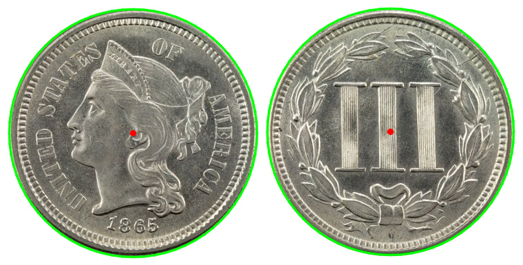
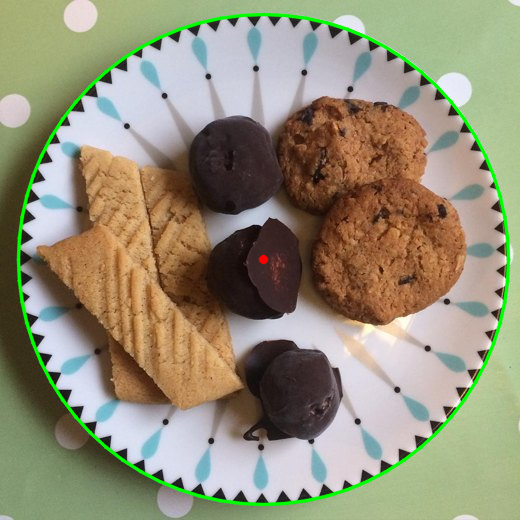

# 霍夫圆检测工具

带本地图形界面的霍夫圆检测工具：导入实拍图片、调节参数、实时预览标注结果并导出 PNG 标注图。两张实拍样图（两枚硬币、饼干盘）已按固定参数验收通过。

当前工作分支是视频导入检测的交接分支：图片检测功能已完成并验收；视频导入、逐帧检测、进度与 CSV 导出尚未实现，需求与后续入口见 [docs/handoff.md](docs/handoff.md) 和 `openspec/changes/add-video-import-detection/`。

## 环境与启动

需要 Python 3.10+、`opencv-python>=4.6` 与 `numpy>=1.21`；HTTP 服务和前端使用标准库，无额外 Web 框架。Ubuntu / WSL2 下：

```bash
python3 -m venv .venv
source .venv/bin/activate
pip install -r requirements.txt
python3 -m hough_circles
```

浏览器访问 <http://127.0.0.1:8000/>。端口被占用时：

```bash
python3 -m hough_circles --port 8080
```

`--host` 可修改监听地址，默认只监听本机。

## 样例获取

两张图片样图已随仓库提供，无需额外下载；来源与许可见 [examples/SOURCES.md](examples/SOURCES.md)。视频功能尚未实现，仓库暂未附带视频样例；接手人需先按 `openspec/changes/add-video-import-detection/tasks.md` 第 1 节补充一段可公开获取的短视频，并在同一来源文件中记录出处与许可。

## 界面用法

| 操作 | 行为 |
| --- | --- |
| 导入图片 | 选择 JPEG/PNG，导入后立即用当前参数检测 |
| 调参 | 拖动滑杆，250 ms 防抖后自动重新检测 |
| 预览 | 显示原分辨率标注图、检出数量、每个圆的圆心与半径 |
| 导出 | 下载 `<原图名>-annotated.png`；无检出结果时按钮禁用 |

| 参数 | 含义 | 范围 | 默认值 |
| --- | --- | --- | --- |
| dp | 累加器分辨率与图像分辨率之比 | 1.0–2.0 | 1.2 |
| minDist | 两个圆心的最小距离（像素） | 10–500 | 100 |
| param1 | Canny 边缘检测高阈值 | 30–300 | 100 |
| param2 | 累加器阈值，越小越容易检出 | 10–150 | 45 |
| minRadius | 最小半径（像素） | 0–600 | 20 |
| maxRadius | 最大半径（像素），0 表示按图像短边一半自动取值 | 0–1200 | 0 |
| blur | 中值滤波核大小 | 1–15 的奇数 | 5 |

## 验收

样图在 `examples/`，验收生成的结果图在 `docs/results/`。复现命令：

```bash
python3 scripts/acceptance.py
```

2026-11-20 在交接分支副本中复跑，退出码为 0，两张样图均通过判据；下表的圆心、半径与边缘支持度与复跑输出一致。视频验收尚未定义，属于交接文档中的未验证事项。

### 硬币图

参数：`dp=1.2, minDist=200, param1=100, param2=50, minRadius=150, maxRadius=210, blur=5`

结果：检出 2 个圆，分别对应两枚硬币的外缘。

| 圆 | 圆心 | 半径 (px) | 边缘支持度 |
| --- | --- | --- | --- |
| 1 | (192.6, 192.6) | 180.0 | 0.56 |
| 2 | (567.0, 191.4) | 179.3 | 0.63 |



### 饼干盘图

参数：`dp=1.2, minDist=200, param1=100, param2=40, minRadius=200, maxRadius=280, blur=5`

结果：检出 1 个圆，对应盘沿。

| 圆 | 圆心 | 半径 (px) | 边缘支持度 |
| --- | --- | --- | --- |
| 1 | (263.4, 258.6) | 245.2 | 0.84 |



边缘支持度是圆周采样点中落在强梯度位置的比例，用于复核检出的圆是否贴合真实边缘。

## 交接状态

- 已完成：图片导入、参数调节、实时预览、PNG 导出；两张样图的固定参数验收。
- 未实现：视频导入、逐帧检测、任务进度/取消、逐帧 CSV 与视频模式界面。OpenSpec 变更 `add-video-import-detection` 当前 4/29 任务完成，均为交接准备项。
- 未验证：视频样例与视频验收判据、OpenCV 对目标视频编码的支持、512 MiB 上传上限、浏览器中的视频模式手工流程。
- 复现与接手入口：[docs/handoff.md](docs/handoff.md)；需求与设计见 `openspec/changes/add-video-import-detection/`。

## 目录结构

```text
hough_circles/   检测核心、HTTP 服务与前端页面
scripts/         验收脚本
examples/        两张实拍样图及来源说明
docs/results/    验收生成的标注图
docs/handoff.md  分支、基线、合并目标与接手入口
openspec/        主规格、归档变更与视频功能的未实施变更
```

## OpenSpec 记录

开发由两轮已归档变更和一轮未实施变更组成：

- `openspec/changes/archive/2026-11-14-add-hough-circle-gui/`：初始实现，含提案、规格、设计与任务清单。
- `openspec/changes/archive/2026-11-14-add-hough-circle-tool/`：按评审流程复核规格与验收，任务 14/14 完成。
- `openspec/changes/add-video-import-detection/`：视频导入与逐帧检测的提案、规格、设计和任务清单；当前 4/29 完成，尚未实现，未归档。

已归档两轮变更同步的主规格：

- `openspec/specs/circle-detection/spec.md`
- `openspec/specs/detection-gui/spec.md`

用 `openspec validate --specs --strict` 校验主规格，用 `openspec list` 查看进行中变更，用 `openspec status --change add-video-import-detection` 查看视频变更的任务进度。

## 样图许可

图片见 [examples/SOURCES.md](examples/SOURCES.md)。视频样例尚未加入；补充时必须在同一文件记录来源与许可。
